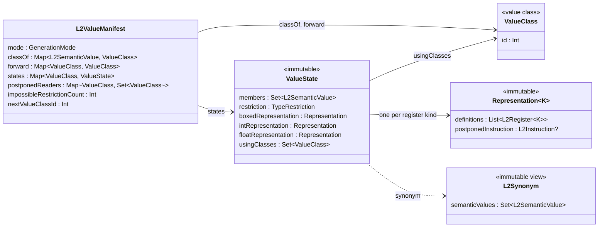

# Value manifest

An [L2ValueManifest] records what the Level Two optimizer knows about the
values available at one point in a control flow graph: which semantic values
name the same value, the [TypeRestriction] bounding each value, which
registers hold it, and which postponed instruction would produce it if no
register does yet.  Every edge ([L2PcOperand]) carries its own manifest, and
the generator keeps a current manifest for the position where it is emitting
instructions.  A manifest is copied when control flow branches, narrowed
differently along each outgoing edge, and rebuilt from the incoming edges'
manifests when control flow merges.

This document describes how a manifest is structured and why, how values are
merged and narrowed, and the invariants that keep it consistent.  How
postponed instructions are moved and emitted is in
[Variable_elision.md](Variable_elision.md); how a block's synonyms and
restrictions survive regeneration of the graph is in
[Post_phi_data.md](Post_phi_data.md).

## Data model

A manifest separates the *identity* of a value from what is known about it.

- A [ValueClass] is the identity: an equivalence class of semantic values,
  holding nothing but a small integer id.
- A [ValueState] is what the manifest knows about one class: its members,
  its restriction, the classes of the primitive invocations computed from it,
  and one [Representation] per [RegisterKind].
- A [Representation] is what is known about the value in one register kind:
  the registers of that kind holding it, and at most one postponed
  instruction that would populate them.
- An [L2Synonym] is an immutable view of a state's members, hashed and
  compared by its member set.  It is how the rest of the optimizer refers to
  a group of synonymous values, and is never a key of the manifest's own
  maps.

### Identity and state

The manifests of a control flow graph share a great deal.  Both outgoing
edges of a branch start from the same manifest, and must agree about which
value is which, while disagreeing about what is known of it: along one edge a
value is an integer, along the other it is not.  So the identity is shareable
and the state is not.

- A `ValueClass` holds no state at all, so the same class can be referred to
  from any number of manifests without one manifest's facts leaking into
  another's.  Merging two classes is recorded in each manifest's own
  [forwarding map](#the-manifests-maps), not in the class.
- A `ValueState` and its `Representation`s are immutable.  A manifest never
  changes a state in place; it builds a new one and replaces its own entry.
  States are therefore safely shared between a manifest and its copies, and
  copying a manifest clones only its maps.

### The manifest's maps

- `classOf` maps each semantic value the manifest knows to its class.  The
  class recorded there may since have been merged away, so every read goes
  through `resolve`.
- `forward` records each class that has been merged into another.  It is a
  union-find structure held entirely in the manifest: `resolve` follows the
  chain to the surviving class and compresses the path as it goes.
- `states` maps each surviving class to its `ValueState`.  A forwarded class
  has no state.
- `postponedReaders` maps a class to the classes whose postponed instructions
  read it (see [Postponed instructions](#postponed-instructions)).
- `impossibleRestrictionCount` counts the states whose restriction is
  impossible, so that `hasImpossibleRestriction` can tell the generator
  without a scan that the current position cannot be reached.
- `nextValueClassId` numbers classes.  Ids are allocated per manifest and
  continue from the original's when a manifest is copied, so a class created
  in a copy cannot collide with one it inherited.

`adoptEverythingFrom` is the one place that knows all of these, and copying
or inheriting a manifest goes through it, so that no part of what the
original knew can be quietly dropped.

### Determinism

Code generation must not vary from run to run, so nothing in a manifest may
iterate in an order that depends on identity hash codes.  `ValueClass`
compares and hashes by its id, which is assigned deterministically, and the
manifest's collections are Kotlin's insertion-ordered `mutableMapOf` and
`mutableSetOf`.  A collection keyed by a class or a semantic value is never
replaced with an explicit `HashMap` or `HashSet`.

### Generation modes

A manifest's [GenerationMode] says how the graph is held together.  In
`BySemanticValue` mode, the manifest tracks semantic values, postpones
instructions, and generates phis by matching semantic values at merges.  In
`ByRegister` and `WithFixedRegisterMap` modes, used by the late phases, the
graph is connected by registers instead: semantic values are not consulted
(`caresAboutSemanticValues` is false), and no representation has a
postponed instruction.  The mode of a long-lived manifest changes as the
phases progress, so it is the mode, not the presence of a map, that decides
whether semantic values are consulted.

### Known, live, and populated

A manifest can know a value without any register holding it.  In each
register kind, a value it knows has registers holding it, a postponed
instruction that would produce it, or neither.  It has neither when it is a
constant, which the generator can produce directly; an argument introduced
for a primitive invocation (see [Introduced arguments](#introduced-arguments));
a value restored by replaying post-phi data; or a value briefly between
being introduced and being written.  A postponed instruction is present
only when some member of the class has no register of that kind, and it is
never a move when the class has no register of that kind at all.

The queries distinguish three degrees of presence:

- *Known*: the value is a member of some class (`hasSemanticValue`).
  `equivalentSemanticValue` finds a known value equivalent to a given one.
- *Live* in a kind: some register of that kind holds the value's class
  (`hasLiveSemanticValue`).
- *Populated* in a kind: some register of that kind was written by an
  instruction whose write names this exact semantic value (`isPopulated`).
  `equivalentPopulatedSemanticValue` finds a populated value equivalent to
  a given one, and `isPopulatedInAnyKind` asks whether the value is
  populated in any kind.

Reading a value that is known but not live forces its postponed
instruction to be emitted, so a caller that only needs to read a value
should use the plain queries, and reuse a postponed equivalent rather than
compute the value again.  The populated queries are for a caller that needs
a register written under that exact name.

Registers and semantic values are not one to one.  In SSA form each
register has a single definition, but one value can be held by several
registers at once: a control flow merge creates new registers for the
values it carries, and a cold block can reconstruct a value that is already
held elsewhere.  That is why a `Representation` holds a list of registers.

## Semantic values

Every member of a state is an [L2SemanticValue].  A value held in an `int`
register and the same value held boxed are the same semantic value; the
register kind of the operand that reads or writes it says which
`Representation` is meant.  Keeping each kind's registers in a
`Representation` of their own is what lets one value be held in several
kinds at once without ever mixing registers of different kinds in one list.

Two kinds of semantic value deserve mention:

- An [L2SemanticConstant] names one particular value.  There is one per
  constant, so finding a constant's class is a lookup.  A class whose
  restriction becomes a single value always includes that value's semantic
  constant (see [Narrowing](#narrowing)).
- An [L2SemanticPrimitiveInvocation] names the result of applying a
  side-effectless primitive to argument semantic values.  Values derived
  from another value are expressed this way: a value's type tag is an
  invocation of `P_ExtractTagOrdinal`, and an object's or object type's
  layout variant id is an invocation of `P_ExtractObjectVariantId` or
  `P_ExtractObjectTypeVariantId`.  Facts flow between an invocation and its
  arguments through the primitive, in both directions (see
  [Narrowing](#narrowing)).

## Restrictions

Each state holds one [TypeRestriction], in boxed form, whatever registers
hold the value.  Its only flags are whether it may describe ⊥
(`CAN_BE_BOTTOM_FLAG`) and whether the value is known to be immutable
(`IMMUTABLE_FLAG`).  A restriction is *impossible* when it equals
`bottomRestriction`, meaning no value satisfies it, which in turn means the
position cannot be reached.

The manifest is the authority on read restrictions.  A read operand does not
store a restriction: while the graph is being generated it asks the current
manifest, and once the graph is complete it asks its block's post-phi data
(see [Post_phi_data.md](Post_phi_data.md#other-uses)).  A write operand
records the restriction of the value it writes.

Restrictions also carry the object and object type layout variants a value
may have.  These are read where no manifest exists: the JVM translation of
the object field instructions, and the dispatch lookup trees, which are built
from bare restrictions outside of Level Two generation.

### The int register invariant

Unboxing to an `int` register extracts a 64-bit value, and the extraction is
not checked at run time.  The guarantee is established beforehand, by a type
test whose passing edge carries the narrower restriction, or by the
restriction already being within the 64-bit range.  So:

> If a value has a non-empty `int` representation, its restriction is
> contained by `i64`.

This is a safety invariant.  [L2_UNBOX_INT] asserts it when added, and
[L2Generator]'s infallible int read asserts it before unboxing.  An
instruction that needs a narrower range, such as 32 bits, asserts that range
itself.

## Merging

Two classes are merged when they are shown to be the same value: by a move,
by an equality test along its equal edge, by a postponed instruction whose
result is a known constant, by replaying post-phi data, and by
[congruence](#congruence).  Merging is a strengthening, and nothing ever
splits a class except a control flow merge, which builds a new manifest
rather than altering an old one.

`agglomerateSynonym` is the general entry point.  It takes semantic values,
some of which may be unknown to the manifest, and a restriction they are
known to satisfy.  If they already form one class, it only narrows that
class.  Otherwise:

- One of the existing classes survives, or a new class is created if none of
  the values was known.  Every other class is forwarded to the survivor.
- The members are the union of the classes' members and the new values.
- The restriction is the intersection of the classes' restrictions and the
  given one, which may be strictly narrower than any of them, or impossible.
  `impossibleRestrictionCount` is adjusted for the states removed and the
  state added.
- Each register kind's `Representation` is reconciled separately: the
  registers of that kind from every class hold the merged value, and a
  postponed instruction is kept only when nothing yet writes the value in
  that kind.  A value with a constant member needs no postponed instruction,
  since a constant can be produced in any kind directly.
- The users (`usingClasses`) are the union of the classes' users.
- If the merged restriction is a single value, its semantic constant joins
  the class, merging with that constant's class if it has one.
- The members are bound to the survivor, which indexes any member that is a
  primitive invocation under the classes of its arguments.

Then congruent users are merged.

### Congruence

If two classes are the same value, then two invocations of one primitive
reading them are the same value as well.  After a merge, the users of the
merged classes are grouped by primitive and by the resolved classes of their
arguments, and each group with more than one class is merged.  That merge
may in turn make *its* users congruent, so the same step follows each merge
of users, as for any other merge.

Congruence holds in this direction only.  Primitives are not injective: two
values can have the same tag without being the same value.  Merging two
invocations never merges their arguments.

### Termination

Every merge reduces the number of classes by at least one, so a cascade of
merges, including the merges congruence triggers, is finite.

## Narrowing

`updateRestriction` narrows a value's restriction, and always intersects:
the new restriction is the old one intersected with the narrowing, so a
narrowing can never weaken what is known.  If the intersection differs from
the old restriction, the change propagates immediately:

1. **Postponed consumers.**  Each postponed instruction that reads the value
   is re-narrowed (see [Postponed instructions](#postponed-instructions)).
2. **Constant.**  If the restriction became a single value, the class gains
   that value's semantic constant, merging with the constant's class if it
   exists.
3. **Users.**  Each primitive invocation computed from the value has its
   result recomputed from the primitive's `returnTypeGuaranteedByVM` and the
   arguments' restrictions, and is narrowed by the result.  This is skipped
   unless every argument satisfies the primitive's declared argument types,
   since the primitive's answer assumes a call that could actually happen.
4. **Arguments.**  Each primitive invocation among the value's members asks
   its primitive what the result's restriction implies about the arguments
   (`propagateManifestRestrictions`), which may narrow them.  Knowing a
   value's tag, for instance, says a good deal about the value.

Each of these narrows through the same entry point, and a step whose
intersection changes nothing propagates no further.  The comparison is
equality of the old and new restrictions, not `isStrongerThan`, which is
reflexive and would always report progress.

### Why recursion, not a worklist

Propagation recurses directly from the point of change.  It needs no
worklist because it damps:

- Restrictions only intersect, so each step either strictly narrows
  something or stops.
- Restrictions form a lattice with a bottom, so there is no infinite
  descending chain to follow.
- Each step reaches its neighbors through a map lookup or a member of the
  state, never through a search, and the neighborhood is small: the
  postponed readers of a class, the users of a value, and the arguments of
  an invocation.  Chains of derived values are short in practice.

So the depth is bounded by the size of the neighborhood, not of the manifest.

## Postponed instructions

In `BySemanticValue` mode, an instruction with no side effect can be
postponed: instead of being emitted, it is recorded in the representation of
the value it writes, and emitted only where the value is read.  The written
semantic values are not baked into the postponed instruction's write
operand; they are supplied from the class's members when it is emitted.
[Variable_elision.md](Variable_elision.md) describes when instructions are
postponed and where they are emitted.  This section describes how the
manifest holds them.

Moves are never recorded.  Postponing a move ([L2_MOVE]) only merges its
destination into its source's class, after which whatever produces the
source, a register or a postponed instruction, produces the destination as
well.  A constant move is not postponed either, since the constant can be
produced wherever it is needed.  Any other instruction is recorded through
`installOrFoldPostponed`: if its write restriction is already a single
value, the class simply joins that value's constant class and nothing is
postponed; otherwise the instruction is installed in the representation of
its kind and indexed in `postponedReaders` under the class of each value it
reads.

### Re-narrowing

When a value is narrowed, each postponed instruction that reads it may now
compute a more precise result.  `renarrowPostponedConsumersOf` finds them
through `postponedReaders`, asks each for a clone with its reads narrowed
(`narrowedForManifest`), computes the restriction those reads imply for its
write (`impliedWriteRestriction`), installs the clone, and narrows the
written value.  If that makes the value a single constant, the postponed
instruction is dropped, and a constant move will be emitted wherever the
value is needed.

The rules that make this sound:

- **Clone, never mutate.**  A postponed instruction is shared by every
  manifest copied from the one that recorded it, including both outgoing
  edges of a branch, whose narrowings contradict each other.  Re-narrowing
  produces a new instruction, which only this manifest holds.
- **Narrow from the manifest.**  The implied write restriction is computed
  from the manifest's restrictions for the reads, never from the producing
  instruction's write operand, so a chain of postponed instructions narrows
  link by link as each written value narrows.
- **Key by class.**  `postponedReaders` is keyed by the class read, not by a
  semantic value.  A narrowing reaches propagation through whichever member
  happened to be narrowed, which is often not the member the postponed
  instruction reads.  When classes merge, `forwardClass` moves the loser's
  readers to the survivor; the reader classes in the sets are resolved only
  when used.

### Refresh at emission

When a postponed instruction is finally emitted, as a clone in the block
that needs its value, the clone's write restriction is intersected with the
manifest's current restriction for the written value
(`refreshRestrictionsFrom`).  That picks up anything learned since the last
re-narrowing, whether or not re-narrowing propagated it, at no cost to
values that are never emitted.  Since the instruction being refreshed is a
fresh clone, mutating it is safe.

## Introduced arguments

A primitive invocation is meaningful only relative to the values it reads,
and congruence works through the arguments' classes.  If `x` and `y` both
have their tags computed and are then shown to be equal, the merge of `x`
and `y` is what makes `Tag(x)` and `Tag(y)` synonymous.  So when an
invocation is bound to a class, every argument the manifest does not yet
know is introduced as a class of its own (`recordInvocationUse`).  This
happens when a value is named only by something computed from it, and at
merges, where a postponed instruction's result can arrive before the values
it reads have been populated.

An introduced argument has no registers and no postponed instruction: it
anchors congruence, and is not a value anything reads from.  Its restriction
starts as the default, which says nothing about it, and the primitive is
then asked what the invocation's restriction implies about its arguments,
narrowing the argument as far as the facts allow.

Dead code removal regenerates the graph without the instructions it found
dead, so a value whose only writer was dead is not written in the new graph.
The synonyms it belonged to are not lost: the regenerator replays each
block's post-phi data at the start of the corresponding new block, which
re-establishes the synonyms and restrictions the old block knew, including
those of values with no writer at all (see
[Post_phi_data.md](Post_phi_data.md#replay)).

## Control flow merges

`populateForMerge` fills an empty manifest for a block with several
predecessors.  A block with one predecessor simply adopts that edge's
manifest, unless phis are being forced at a loop head.

In `BySemanticValue` mode:

1. Each incoming manifest first simplifies its postponed instructions.
2. The live semantic values are those known on every incoming edge, and
   producible on every incoming edge, by a register, a postponed
   instruction, or a constant.
3. Postponed instructions are reconciled across the edges
   (`mergeIncomingPostponedInstructions`).  Each edge's postponed
   instructions are paired with the synonyms they would populate, as
   [InstructionEquivalence]s, which compare instructions with
   `equivalentTo` rather than identity.  An instruction present on every
   edge is carried past the merge, still postponed.  An instruction present
   on only some edges is emitted in its predecessor, after splitting the
   edge if necessary.  Emitting one can change the manifests, so this
   repeats until the edges agree, and the live values are recomputed.
4. The live values are grouped by the list of synonyms they belong to on
   each incoming edge.  Each group becomes one class of the new manifest:
   values that were synonymous on every edge stay synonymous, and values
   that were synonymous on only some edges are split.  This is the one place
   where a class is split, and the information lost here is what code
   splitting exists to recover.
5. A group containing a constant is the same constant on every edge, and is
   kept as is.  Any other group is populated in one register kind, chosen
   to avoid phis and reboxing where possible, and gets a phi if the edges
   hold it in different registers.  Its restriction is the union of the
   edges' restrictions.

Binding each new class's members rebuilds the index of users, so it never
needs to be carried across a merge separately.

In the register-connected modes, there are no postponed instructions, and
the merge is computed from the registers common to the incoming edges.

## Equivalence search

`equivalentSemanticValue` and `equivalentPopulatedSemanticValue` look for a
semantic value in the manifest that is equivalent to a probe: the probe
itself, a member of its class, a value whose restriction is the constant
that the probe names, or an invocation of the same primitive whose arguments
are recursively equivalent (`isEquivalentSemanticValue`).  When the probe is
in the manifest, or populated in the requested kind, the answer is
immediate.  Otherwise the manifest's semantic values are scanned.

The scan considers only candidates of the probe's own concrete class, unless
the probe is a semantic constant or is present in the manifest.  That is
sound because, for an absent probe that is not a constant, every way
`isEquivalentSemanticValue` can succeed requires the two values to have the
same concrete class:

- Equality: the `equals` of every semantic value class requires the other
  value to be of that same, final class.
- Membership in one class requires the probe to be in the manifest, which
  is excluded.
- A constant probe can match a value of any class, which is why a constant
  probe is never filtered.
- A constant candidate matches only a probe present in the manifest, which
  is excluded.
- Two primitive invocations are of the same class.

Filtering keeps the candidates' order, and every candidate that could match
survives the filter, so the value found is the one an unfiltered scan would
find.

## Consistency checking

`check()` verifies a manifest's internal consistency, and does nothing
unless `deepManifestDebugCheck` is set, since it is far too slow to run
routinely.  It asserts:

- each semantic constant belongs to only one class;
- the classes reachable from `classOf`, once resolved, are exactly the keys
  of `states`;
- every argument of every primitive invocation in the manifest is known to
  it;
- in each representation, the members its registers define are members of
  the class, and a postponed instruction is present only where some member
  is not yet defined, and writes no explicit semantic values;
- no register appears in two places, except under a fixed register map;
- `impossibleRestrictionCount` equals the number of impossible states.

### The paired-update window

`classOf` and `states` must be updated together, and between the two
updates the invariants above do not hold.  That window is deliberate and
kept as short and as local as possible: the paired update happens inside a
single private operation, which does not call `check()` partway through, and
no public operation returns with the two maps disagreeing.

## Rejected alternatives

### A mutable L2Synonym

An `L2Synonym` that compared by identity and whose member set grew in place
would seem to provide a stable class identity without a separate
`ValueClass`.  It cannot work: synonyms are shared between the manifests of
a graph, so growing one along one edge of a branch would change it along the
other.  It also conflates identity with state, which are separated
precisely so that one can be shared and the other cannot.  Several uses
also depend on synonyms comparing by their members: grouping live values by
their per-edge synonyms at a control flow merge, matching postponed
instructions across edges as `InstructionEquivalence`s, and keying post-phi
data by synonym.

### Keying the manifest by value and kind

Keying the manifest's maps by a pair of semantic value and register kind
would also keep different kinds' registers apart, but it gives no stable
identity for a class, no union, and no way to reach a value's neighbors
except by search.  A `ValueState` with one `Representation` per kind keeps
the kinds apart and provides all three.

### A worklist for narrowing

Spreading propagation over a worklist was considered when each propagation
step had to search the manifest for the values to narrow next, which made
each step expensive.  Once neighbors are reached by lookup, a step costs a
few map accesses, and a worklist would add indirection without bounding
anything that is not already bounded (see
[Why recursion, not a worklist](#why-recursion-not-a-worklist)).

[L2ValueManifest]: ../../../src/main/kotlin/avail/optimizer/manifest/L2ValueManifest.kt
[ValueState]: ../../../src/main/kotlin/avail/optimizer/manifest/L2ValueManifest.kt
[Representation]: ../../../src/main/kotlin/avail/optimizer/manifest/L2ValueManifest.kt
[ValueClass]: ../../../src/main/kotlin/avail/optimizer/ValueClass.kt
[L2Synonym]: ../../../src/main/kotlin/avail/optimizer/L2Synonym.kt
[L2PcOperand]: ../../../src/main/kotlin/avail/interpreter/levelTwo/operand/L2PcOperand.kt
[TypeRestriction]: ../../../src/main/kotlin/avail/interpreter/levelTwo/operand/TypeRestriction.kt
[RegisterKind]: ../../../src/main/kotlin/avail/interpreter/levelTwo/register/RegisterKind.kt
[GenerationMode]: ../../../src/main/kotlin/avail/optimizer/L2Optimizer.kt
[L2SemanticValue]: ../../../src/main/kotlin/avail/optimizer/values/L2SemanticValue.kt
[L2SemanticConstant]: ../../../src/main/kotlin/avail/optimizer/values/L2SemanticConstant.kt
[L2SemanticPrimitiveInvocation]: ../../../src/main/kotlin/avail/optimizer/values/L2SemanticPrimitiveInvocation.kt
[L2_UNBOX_INT]: ../../../src/main/kotlin/avail/interpreter/levelTwo/operation/numbers/L2_UNBOX_INT.kt
[L2_MOVE]: ../../../src/main/kotlin/avail/interpreter/levelTwo/operation/L2_MOVE.kt
[L2Generator]: ../../../src/main/kotlin/avail/optimizer/L2Generator.kt
[InstructionEquivalence]: ../../../src/main/kotlin/avail/interpreter/levelTwo/L2Instruction.kt
