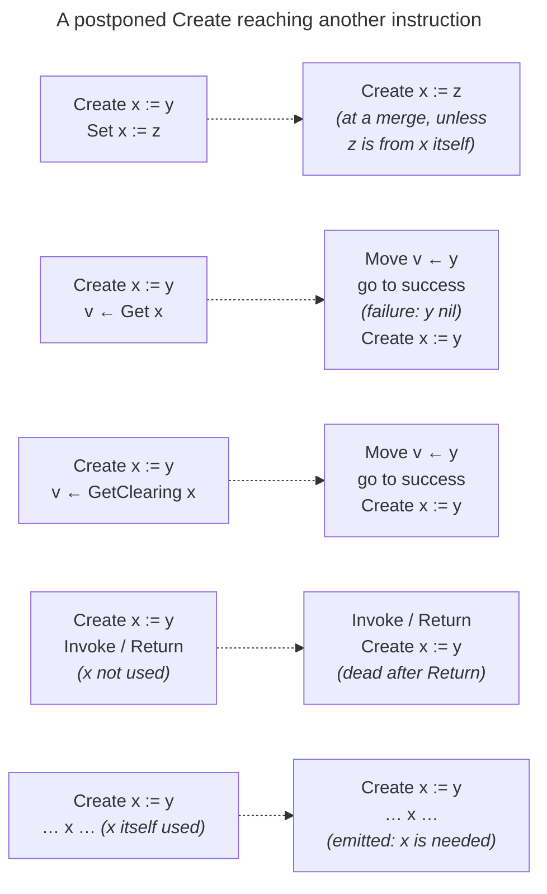
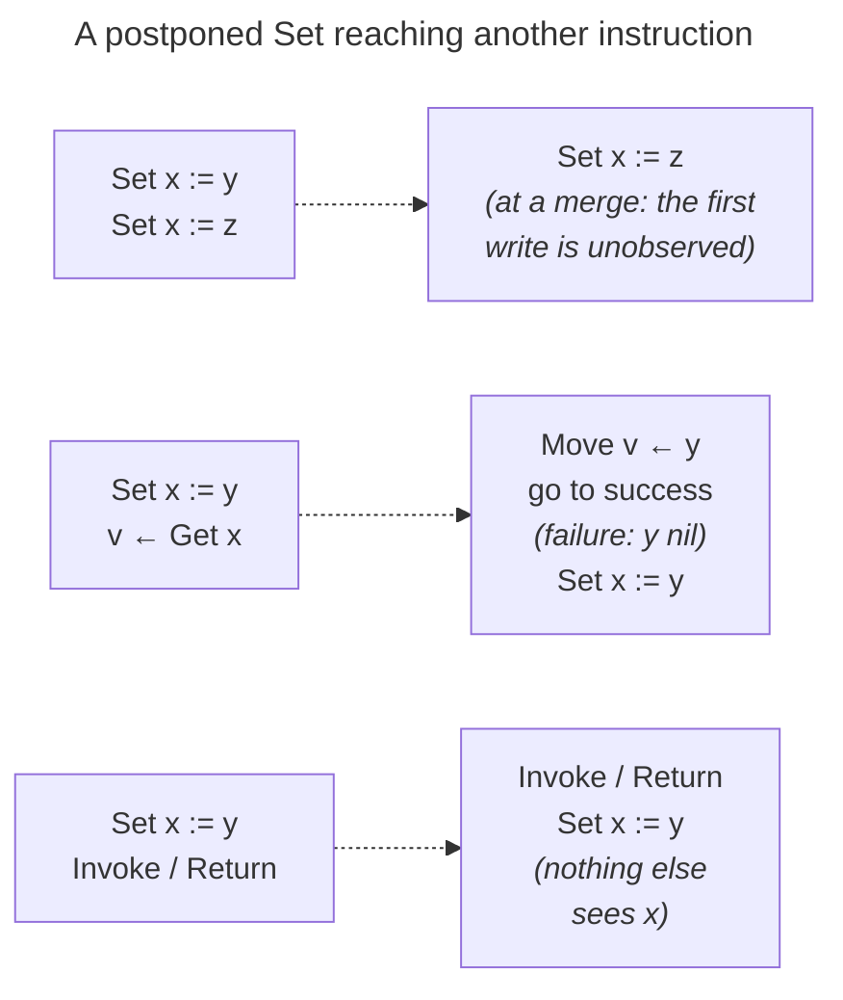
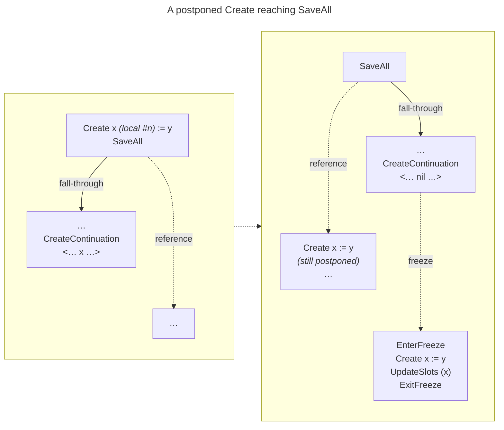
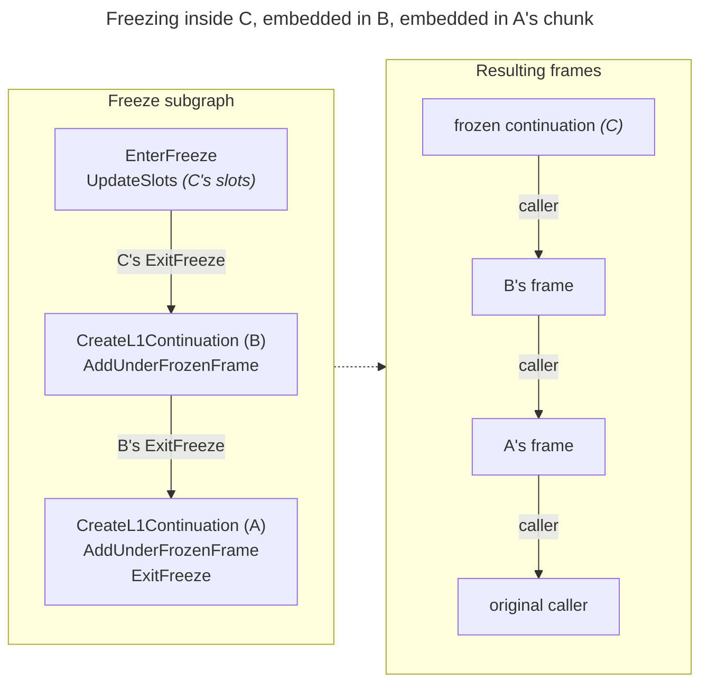

# Variable Elision

Level Two code avoids creating the variable object for a local variable of
the function being optimized until something could observe that object.  An
*elided* local exists only as the values in registers that it would hold:
its creation and its writes are postponed, and a read of it becomes a move of
the value most recently written.  The variable is created when something needs
the variable object itself, such as the frame's continuation being reified
and then made immutable or shared.

Two distinct hazards end a local's elision, and this document names them
separately:

- A local is *aliased* when the code hands out the variable itself, rather
  than its value: to close a function over it, to put it in a tuple, or to
  pass it as an argument.  Other code may then read or write the same
  variable, so its accesses must stay ordered against that code.  Aliasing is
  decided statically, before translation (see [Aliased
  locals](#aliased-locals)), and an aliased local is never elided.
- A variable has *escaped* when it has become shared or has acquired a
  reactor.  Its value can then change, or a write to it must run code, outside
  the knowledge of L2, so the fast elidable-local accesses are no longer
  valid.  Only code holding the variable can share it or give it a reactor,
  so an elided local can escape only through its frame's continuation, and
  that frame then resumes in L1 (see [Escape](#escape)).

The governing invariant is that **L1 code only ever sees real variables**.
Any continuation that would expose an elided local to the L1 interpreter, or
to another fiber, first creates the missing variables and switches its own
resumption to the L1 interpreter.

## Scope

Elision applies to the local variables of a raw function (the slots after
its arguments), in chunks that the [L1Translator] and the L2 optimizer
produce.  The unoptimized [DefaultL1Chunk] and the [L2SimpleChunk] create
every local up front, as does the optimizer when
`L1Translator.enableVariableElision` is `false`.  Even when elision is
enabled, an aliased local is not elided.

## Aliased locals

Before translating a raw function, the [L1Translator] scans its nybblecodes
for `L1_doPushLocal` and `L1_doPushLastLocal` applied to a local slot.  Those
are the only L1 operations that push the variable itself, so the locals they
name are exactly the aliased ones.  The decision covers the whole function:
a local pushed on any path is aliased on every path, from the start.

An aliased local is created at the head of the function's body, before the
interrupt check, by a `Create x := nil` that is not marked elidable.  Such a
`Create` is never postponed, so it never reaches `SaveAll`, and the variable
exists wherever the local is used.  Every read and write
of an aliased local uses the general variable instructions,
[L2_GET_VARIABLE], [L2_GET_VARIABLE_CLEARING_IF_MUTABLE], and
[L2_SET_VARIABLE], none of which is ever postponed.  So each access happens
where the L1 code put it, in order with any call that might run code holding
the same variable, and with any read of the variable taken back out of a
tuple.  Those instructions also handle a shared variable and write reactors
themselves.

## Instructions

The mechanism is carried by ordinary L2 instructions that the postponement
machinery knows how to transform.  The diagrams below use the shorthand on
the left.

- **`Create x := y`** — [L2_CREATE_VARIABLE].  Create local `#n`, initialized
  to `y`, or unassigned if `y` is `nil`.  It is marked elidable unless the
  local is aliased, and only an elidable one can be postponed.
- **`Set x := y`** — [L2_SET_ELIDABLE_LOCAL_VARIABLE].  Write `y` into `x`
  with no type check and no write reactors, which is valid because an
  elidable local is neither shared nor reactive while its L2 code runs (see
  [Escape](#escape)).  It produces `x` again under a new semantic value, so
  every later use of the local is ordered after the write.  It can be
  postponed.
- **`v ← Get x`** — [L2_GET_ELIDABLE_LOCAL_VARIABLE].  Read `x` into `v`,
  branching on whether `x` is assigned, and produce `x` again.  It branches,
  so it is never postponed.
- **`v ← GetClearing x`** — the same instruction with the clear mode
  `ClearIfMutable`.  Like `Get`, but also clear `x` if it is mutable, so the
  value read need not be made immutable.  The compiler emits the clearing read
  only for the last read of a local (`AvailGetLocalVariable.canClear`).
- **`SaveAll`** — [L2_SAVE_ALL_AND_PC_TO_INT].  Begin reifying this frame,
  capturing the registers live where it resumes in an [A_RegisterDump].
- **`CreateContinuation`** — [L2_CREATE_CONTINUATION].  Build the frame's
  continuation, with the dump.  A slot whose variable has not been created
  holds `nil`, and a *freeze* edge leads to the subgraph that creates those
  variables (see [Freezing](#freezing)).
- **`EnterFreeze`** — [L2_ENTER_FREEZE].  Start a freeze subgraph, restoring
  the registers it needs from the dump.
- **`UpdateSlots`** — [L2_UPDATE_SLOTS].  Write variables into the frame
  slots of the continuation being frozen.
- **`ExitFreeze`** — [L2_EXIT_FREEZE].  End a freeze subgraph.  In a callee
  embedded in another chunk, it becomes a jump to the call site's freeze
  block instead (see [Embedded frames](#embedded-frames)).
- **`CreateL1Continuation`** — [L2_CREATE_L1_CONTINUATION].  In a freeze
  subgraph, build the frame of a call that was inlined around the continuation
  being frozen, as level one would have reified it.
- **`AddUnderFrozenFrame`** — [L2_ADD_UNDER_FROZEN_FRAME].  Slide such a frame
  beneath the frames built so far.
- **`Invoke`** — [L2_INVOKE] or [L2_INVOKE_CONSTANT_FUNCTION]: a call that is
  not inlined.
- **`Return`** — [L2_RETURN].

## Translation

The [L1Translator] emits one `Create x := nil` per local at the head of the
function's body, before the interrupt check.  The `Create` of an elidable
local is postponed from the start, so a continuation reified to service that
interrupt already has a freeze subgraph that creates it (see
[Reification](#reification)).

The L1 operations that read and write an elided local translate to `Get`,
`GetClearing`, and `Set`.  Those of an aliased local translate to the general
variable instructions instead (see [Aliased locals](#aliased-locals)).

## Escape

A local that has become shared is open to reads and writes from other fibers,
so L2 can no longer track its value in registers.  A local with a reactor
must run that reactor on each write, which `Set` does not do.  Neither can
happen to an elided local while its L2 code still runs.

Sharing a variable or adding a reactor to it takes a reference to the
variable object, and an elided local's object is never handed to other code:
a local whose variable is pushed is aliased, not elided.  The variable object
of an elided local, once created, is held only by its own frame.  The frame's
continuation can be reached by other code only after it is reified and made
immutable or shared, by label creation, the debugger, or another fiber.  That
transition freezes the continuation (see [Freezing](#freezing)), which
switches it to the L1 interpreter, so the L2 code that elided the local never
resumes with it.

## Postponement

A side-effect-free instruction with a single output can be *postponed*: the
regenerator records it in the edge's [L2ValueManifest] instead of emitting it,
and emits it only when something reads its output.  `Create` and `Set` are
postponable, and the rules below say what happens when one of them, still
postponed, reaches another instruction.

The initial translation by the [L1Translator] applies these rules, and so does
every regeneration that tracks semantic values, such as code splitting.  There
is no separate postponement pass.

The merging of a `Create` or `Set` with a following `Set`
(`L2Instruction.rewritePostponed`) happens only on the edges into a control
flow merge (`L2ValueManifest.populateForMerge`), where both are still
postponed.  Elsewhere the `Set` stays postponed on top of the instruction that
produced its variable.

### Postponed creation

When the value `y` might or might not be assigned, the `Get` reads the
variable, which forces the `Create` to be emitted first.  After a
`GetClearing`, the postponed creation keeps its initial value: the clearing
read is the local's last read, so nothing observes the difference, and the
creation is never emitted unless something later needs the variable itself.

### Postponed assignment

A postponed `Set` may follow a postponed `Create` or another postponed `Set`
until they reach a control flow merge, where they merge into one.

Like any postponed instruction, a `Set` is also emitted as soon as anything
reads the variable it produces.  An elided local is never aliased, so no
invoked code can read or write it, and a `Set` may pass an `Invoke` or a
`Return`.  After a `Return`, the `Set` is dead.  If the frame is reified
during the `Invoke`, the `Set` stays postponed past the creation of its
continuation, and is emitted in that continuation's freeze subgraph (see
[Reification](#reification)).

### Reification

`SaveAll` has two outgoing edges: the *fall-through* edge, which goes on to
build and store the frame's continuation, and the *reference* edge, where
execution resumes when that continuation is returned into while still
mutable.  A postponed `Create` follows both.

Along the reference edge the creation stays postponed, so a frame that is
resumed while its continuation is still mutable continues in L2 with its
locals still elided.

Along the fall-through edge the creation also stays postponed, until it
reaches the `CreateContinuation`.  There, each frame slot holding a variable
whose `Create`, or the `Set` that follows it, is still postponed is written
as `nil` instead, so the `Create` stays postponed past the
`CreateContinuation`, and is dead along its fall-through edge.  The
`CreateContinuation` then gets a freeze edge, which the postponed
instructions follow into a new freeze subgraph: an `EnterFreeze`, then an
`UpdateSlots` that writes the variable of each slot written as `nil` back
into that slot, then an `ExitFreeze`.  Reading those variables forces their
`Create`s and `Set`s, which are therefore emitted in the freeze subgraph and
nowhere else along this path.

A `CreateContinuation` starts with no freeze edge, and gains one, with its
freeze subgraph, the first time it is emitted by translation or by a
regeneration that tracks semantic values with some creation still postponed
there.  While a callee's graph is being embedded in another chunk, it gains
one even with nothing postponed there (see
[Embedded frames](#embedded-frames)).  After that, each regeneration
regenerates the freeze subgraph along with the rest of the graph, since the
`Create`s it forces exist nowhere else along this path.  A creation that
reaches a `CreateContinuation` that already has a freeze edge, as when a later
regeneration postpones it further, is emitted before the `CreateContinuation`
instead, as is any postponed instruction that cannot run in a freeze (see
[The freeze method](#the-freeze-method)).

Control never flows along the freeze edge.  Like the reference edge of
`SaveAll`, it carries the manifest and determines which registers are live,
and JVM translation turns it into saved and restored registers (see
[Freezing](#freezing)).

## Freezing

A continuation is *frozen* when its elided locals are created, the frames of
any calls inlined around it are built, and it is switched to resume in the L1
interpreter.
`ContinuationDescriptor.createElidedVariables` freezes a continuation.  It
runs:

- when the continuation becomes immutable or shared, from
  `o_MakeImmutableInternal` and `o_MakeSharedInternal`;
- when the interpreter returns into a reified continuation whose chunk has
  been invalidated, or while a debugger is attached
  (`Interpreter.checkValidity`).

A mutable continuation belongs to its fiber, and is returned into at most
once along the path that created it, so L2 can restore its registers and
carry on with its locals still elided.  Once the continuation is immutable,
it can be examined or resumed more than once, and each of those must see the
same variable objects.  Once it is shared, other fibers can reach it, and
through it the locals, which exposes them to concurrent modification.  Either
way the locals have escaped, so they are created, and the continuation
resumes in the L1 interpreter, whose execution only uses real variables.  An
invalidated chunk cannot be resumed in L2 at all, though its freeze method
still runs, so its frame likewise resumes in L1, with real variables.  A
frozen continuation whose enclosing frames were
built cannot resume in L2 either: its chunk would go on to run the code of
those frames itself, and the frozen frame would then return into the frames
that were built, running that code a second time.

It calls the `freeze` method of the continuation's chunk
(`ExecutableChunk.freeze`), then sets the continuation's chunk to the
[DefaultL1Chunk], at the dump's `fallbackEntryPoint`.  It does nothing for a
continuation of the [DefaultL1Chunk] or of an [L2SimpleChunk], neither of
which elides locals, or for a continuation without a register dump.  It also
does nothing when the dump has no freeze subgraph (a `FREEZE_OFFSET` of -1)
and the function has no locals: nothing was postponed and no enclosing frame
is missing, so the continuation can keep resuming in L2.

### Embedded frames

When the optimizer embeds a callee's graph in its caller's chunk
(`L2Inliner`), the callee's frame exists only as registers of that chunk.  A
reification inside the embedded code builds one continuation for the whole
chunk.  It is the frame of the innermost embedded call, its dump holds every
register live there, including those of the frames around it, and its caller
is the chunk's own caller.  Resumed in L2, it restores all of those
registers.  Level one, however, resumes one frame per continuation, so
freezing it must build the frames that the embedding left out.

While a callee's graph is being embedded, every `CreateContinuation` gets a
freeze subgraph, even one with nothing postponed there
(`L2GeneratorInterface.freezesBuildEnclosingFrames`).  The callee's
`ExitFreeze` does not end the freeze: it becomes a jump to the freeze block
of the call site (`L2Inliner.exitFreeze`), which
`L1Translator.generateFreezeOfCaller` fills with:

- a `CreateL1Continuation`, which builds the caller's frame as level one would
  have reified it during the call: its slots, with the call's expected type
  at its stack pointer, resuming in the [DefaultL1Chunk] at
  `REENTRY_FROM_REIFIED_CALL`, with no dump and no caller;
- an `AddUnderFrozenFrame`, which slides that frame beneath the outermost
  frame built so far;
- an `ExitFreeze`, which, when the caller is itself embedded in another
  chunk, becomes a jump to the freeze block of the caller's own call site in
  turn.

The frames are therefore built innermost first.  Each one slides between the
frame built before it and that frame's caller, so the last one, the frame of
the chunk's own function, takes the frozen continuation's original caller.
Reading a caller's slots for its `CreateL1Continuation` forces the postponed
`Create`s and `Set`s of the caller's elided locals, so they are emitted in
that freeze block, just as the frozen frame's own are emitted before its
`UpdateSlots`.

### The freeze method

A chunk translated to JVM code has a `freeze` method if it has any freeze
subgraphs; every other chunk inherits one that does nothing.  The freeze
subgraphs are translated into that method rather than into `runChunk`.  Like
`runChunk`, it starts with a lookupswitch on an L2 offset, in this case the
dump's `FREEZE_OFFSET`, which is the offset of the `EnterFreeze` of the
continuation's freeze subgraph, or -1 to return at once.  It takes the
continuation in place of the interpreter, which it does not have, since a
continuation can be frozen on any thread.  Code in the freeze subgraph that
would use the interpreter only as an optimization does without: boxing an int
does not use the interpreter's recycling pool.

The method keeps the outermost frame built so far in a JVM local, which
starts as the continuation being frozen.  Each `AddUnderFrozenFrame` replaces
it with the frame it slides.  `UpdateSlots` comes before any of them, and
writes into the continuation being frozen.

Only an instruction that can run without an interpreter may travel along a
freeze edge.  `L2Instruction.canRunInFreeze` says whether a postponed
instruction can.  For an `L2_RUN_INFALLIBLE_PRIMITIVE` it is true only when
the primitive is `Isolated`, needing nothing of what runs it but a way to
fail.  Whenever a `CreateContinuation` has a freeze subgraph, each postponed
instruction that cannot run in a freeze is emitted before it, where there is
an interpreter.  An isolated primitive runs in the freeze method with
`FreezePrimitiveContext` as its context.  Its invocation was infallible where
it was translated, so a failure there is a broken invariant of the optimizer.

The freeze method of an invalidated chunk still runs, since returning into
a continuation of that chunk freezes it before it resumes in L1.  The
chunk's freeze subgraphs may come from callees it embedded under method
definitions that have since been removed, and that is still correct.  A
freeze subgraph makes no calls and performs no lookups, so it never
consults the methods as they are now.  It only completes state that the
continuation already owes: the variables of locals that were elided, and
the frames of calls embedded around it.  Those calls really happened, under
the definitions in force when they were made, so building their frames
from the code that was running them is exactly what reification would have
produced at that time.

The dump holds what the freeze subgraph needs.  When JVM translation finds a
`CreateContinuation` with a freeze edge, it finds the `SaveAll` whose dump that
`CreateContinuation` uses, by following the fall-through edge backward.  That
`SaveAll` creates its dump with room reserved after its own registers, one
object slot for each boxed register live along the freeze edge, and one long
slot for each int or float register.  The `CreateContinuation` fills that
room with those registers' values and records the `FREEZE_OFFSET`, and the
`EnterFreeze` restores them into the same registers.  The registers that
`SaveAll` saved come first and are unchanged, so resuming the continuation
in L2 restores them as before.  The values reserved for freezing are the
values at the `CreateContinuation`, so later changes to those registers
along its fall-through edge cannot affect them.

A dump with reserved room is always a new one, never the shared empty dump,
since it must hold its `FREEZE_OFFSET`.  The shared empty dumps have a
`FREEZE_OFFSET` of -1.

[A_RegisterDump]: ../../../src/main/kotlin/avail/descriptor/representation/A_RegisterDump.kt
[DefaultL1Chunk]: ../../../src/main/kotlin/avail/optimizer/DefaultL1ExecutableChunk.kt
[L1Translator]: ../../../src/main/kotlin/avail/optimizer/L1Translator.kt
[L2SimpleChunk]: ../../../src/main/kotlin/avail/interpreter/levelTwo/L2SimpleChunk.kt
[L2ValueManifest]: ../../../src/main/kotlin/avail/optimizer/manifest/L2ValueManifest.kt
[L2_ADD_UNDER_FROZEN_FRAME]: ../../../src/main/kotlin/avail/interpreter/levelTwo/operation/L2_ADD_UNDER_FROZEN_FRAME.kt
[L2_CREATE_CONTINUATION]: ../../../src/main/kotlin/avail/interpreter/levelTwo/operation/L2_CREATE_CONTINUATION.kt
[L2_CREATE_L1_CONTINUATION]: ../../../src/main/kotlin/avail/interpreter/levelTwo/operation/L2_CREATE_L1_CONTINUATION.kt
[L2_CREATE_VARIABLE]: ../../../src/main/kotlin/avail/interpreter/levelTwo/operation/variables/L2_CREATE_VARIABLE.kt
[L2_ENTER_FREEZE]: ../../../src/main/kotlin/avail/interpreter/levelTwo/operation/L2_ENTER_FREEZE.kt
[L2_EXIT_FREEZE]: ../../../src/main/kotlin/avail/interpreter/levelTwo/operation/L2_EXIT_FREEZE.kt
[L2_GET_ELIDABLE_LOCAL_VARIABLE]: ../../../src/main/kotlin/avail/interpreter/levelTwo/operation/variables/L2_GET_ELIDABLE_LOCAL_VARIABLE.kt
[L2_GET_VARIABLE]: ../../../src/main/kotlin/avail/interpreter/levelTwo/operation/variables/L2_GET_VARIABLE.kt
[L2_GET_VARIABLE_CLEARING_IF_MUTABLE]: ../../../src/main/kotlin/avail/interpreter/levelTwo/operation/variables/L2_GET_VARIABLE_CLEARING_IF_MUTABLE.kt
[L2_INVOKE]: ../../../src/main/kotlin/avail/interpreter/levelTwo/operation/L2_INVOKE.kt
[L2_INVOKE_CONSTANT_FUNCTION]: ../../../src/main/kotlin/avail/interpreter/levelTwo/operation/L2_INVOKE_CONSTANT_FUNCTION.kt
[L2_RETURN]: ../../../src/main/kotlin/avail/interpreter/levelTwo/operation/L2_RETURN.kt
[L2_SAVE_ALL_AND_PC_TO_INT]: ../../../src/main/kotlin/avail/interpreter/levelTwo/operation/L2_SAVE_ALL_AND_PC_TO_INT.kt
[L2_SET_ELIDABLE_LOCAL_VARIABLE]: ../../../src/main/kotlin/avail/interpreter/levelTwo/operation/variables/L2_SET_ELIDABLE_LOCAL_VARIABLE.kt
[L2_SET_VARIABLE]: ../../../src/main/kotlin/avail/interpreter/levelTwo/operation/variables/L2_SET_VARIABLE.kt
[L2_UPDATE_SLOTS]: ../../../src/main/kotlin/avail/interpreter/levelTwo/operation/L2_UPDATE_SLOTS.kt
