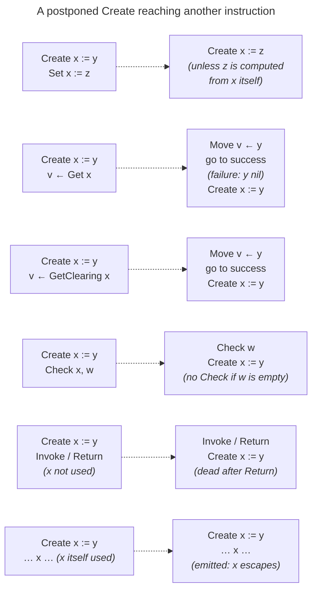
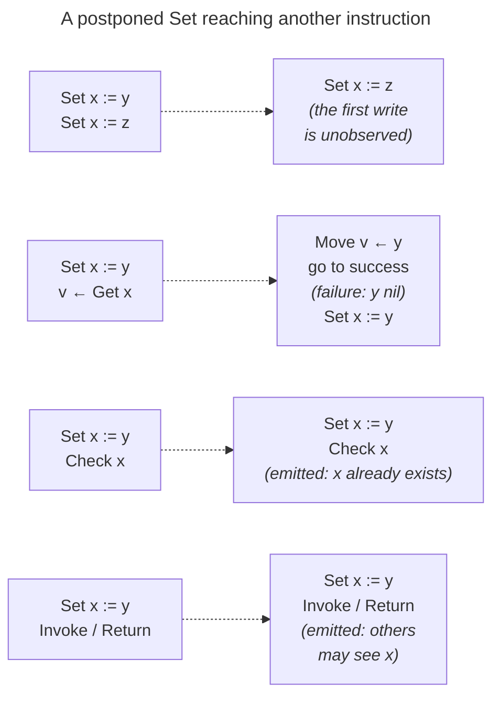
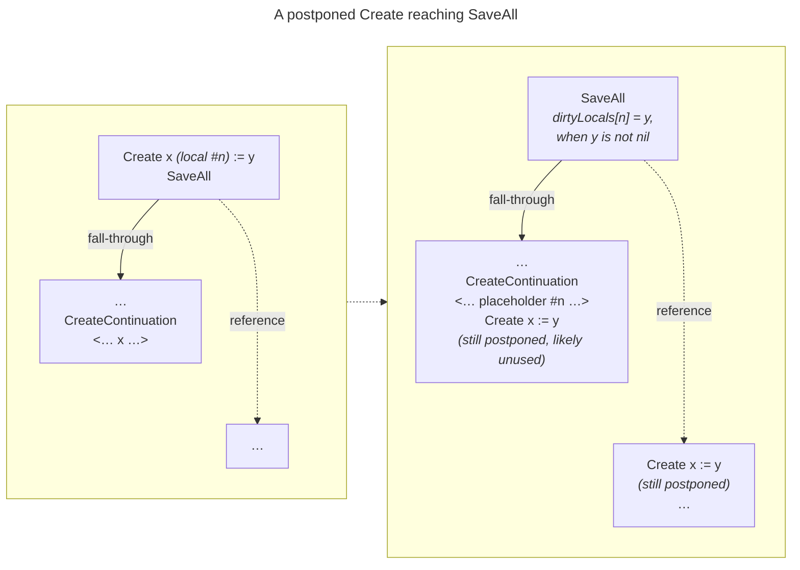

# Variable Elision

Level Two code avoids creating the variable object for a local variable of
the function being optimized until something could observe that object.  An
*elided* local exists only as the values in registers that it would hold:
its creation and its writes are postponed, and a read of it becomes a move of
the value most recently written.  The variable is created when it *escapes*
(when the code passes, captures, or stores the variable itself), or when the
frame's continuation is reified and then made immutable or shared.

The governing invariant is that **L1 code only ever sees real variables**.
Any continuation that would expose an elided local to the L1 interpreter, or
to another fiber, first creates the missing variables and switches its own
resumption to the L1 interpreter.

## Scope

Elision applies to the local variables of a raw function (the slots after
its arguments), in chunks that the [L1Translator] and the L2 optimizer
produce.  The unoptimized [DefaultL1Chunk] and the [L2SimpleChunk] create
every local up front, as does the optimizer when
`L1Translator.enableVariableElision` is `false`.

## Instructions

The mechanism is carried by ordinary L2 instructions that the postponement
machinery knows how to transform.  The diagrams below use the shorthand on
the left.

- **`Create x := y`** — [L2_CREATE_VARIABLE].  Create local `#n`, initialized
  to `y`, or unassigned if `y` is `nil`.  It also carries the placeholder for
  local `#n` (see [Placeholders](#placeholders)), to stand in for the
  variable if the creation never happens.  It can be postponed.
- **`Set x := y`** — [L2_SET_UNESCAPED_LOCAL_VARIABLE].  Write `y` into `x`
  with no type check and no write reactors, which is valid only while `x` is
  neither shared nor reactive.  It produces `x` again under a new semantic
  value, so every later use of the local is ordered after the write.  It can
  be postponed.
- **`v ← Get x`** — [L2_GET_UNESCAPED_LOCAL_VARIABLE].  Read `x` into `v`,
  branching on whether `x` is assigned, and produce `x` again.  It branches,
  so it is never postponed.
- **`v ← GetClearing x`** —
  [L2_GET_AND_CLEAR_IF_MUTABLE_UNESCAPED_LOCAL_VARIABLE].  Like `Get`, but
  also clear `x` if it is mutable.  The compiler emits the clearing read only
  for the last read of a local (`AvailGetLocalVariable.canClear`).
- **`Check x, …`** — [L2_CHECK_ESCAPED_LOCALS].  If any listed local has
  become shared or has acquired a reactor, fall back to the L1 interpreter.
- **`SaveAll`** — [L2_SAVE_ALL_AND_PC_TO_INT].  Begin reifying this frame,
  capturing its live registers in an [A_RegisterDump], along with how to
  create each elided local (its `dirtyLocals` and `dirtyLocalIndices`).
- **`CreateContinuation`** — [L2_CREATE_CONTINUATION].  Build the frame's
  continuation from the dump.
- **`Invoke`** — [L2_INVOKE] or [L2_INVOKE_CONSTANT_FUNCTION]: a call that is
  not inlined.
- **`Return`** — [L2_RETURN].

## Placeholders

Each elided local has a placeholder, an instance of
[VariablePlaceholderDescriptor] that records the local's index and variable
type, compares by identity, and prints as `Elided local #n`.  A continuation
slot holds a placeholder where the real variable has not been created.

The [L1Translator] creates the placeholders at the head of the function's
body.  It binds each local's slot to its placeholder, emits the interrupt
check, and only then emits one `Create x := nil` per local.  A continuation
reified to service that interrupt therefore holds placeholders for every
local.  Anywhere else, a `Create` that is still postponed when the frame is
reified is replaced on the reification path by its placeholder (see
[Reification](#reification)).

## Translation

- The L1 operations that read and write a local translate to `Get`,
  `GetClearing`, and `Set`.
- An L1 instruction that captures or pushes the variable itself (to close a
  function over it, or to pass it as an argument) reads the variable's
  register, which forces the `Create` to be emitted.  That is the local's
  escape.
- After an operation that might make an escaped local shared or give it a
  reactor, the translator emits `Check` over every local slot that is not
  bound to a constant.  (A slot bound to a placeholder, or to `nil` after a
  clearing read, holds no variable to check.)  Those operations are:
  - every call that is not inlined;
  - every inlined primitive that has the flag
    `Primitive.Flag.MightMakeEscapedVariableShared`, such as `P_SetValue`,
    `P_Fork`, and `P_AddWriteReactor`;
  - every write to a variable that is a literal of the code, which is always
    shared, so it may share anything written into it.

A local that has become shared is open to reads and writes from other fibers,
so L2 can no longer track its value in registers.  A local with a reactor
must run that reactor on each write, which `Set` does not do.  Either way,
`Check` falls back to the L1 interpreter ([L2_FALL_BACK_TO_L1]), which
creates any locals still elided and uses only real variables from then on.

## Postponement

A side-effect-free instruction with a single output can be *postponed*: the
regenerator records it in the edge's [L2ValueManifest] instead of emitting it,
and emits it only when something reads its output.  `Create` and `Set` are
postponable, and the rules below say what happens when one of them, still
postponed, reaches another instruction.

Most rules take effect in any regeneration that tracks semantic values: the
merging of a `Create` or `Set` with a following `Set`
(`L2Instruction.rewritePostponed`), the pruning of `Check`
(`L2Instruction.aboutToAdd`), and the handling of `SaveAll`.  Two take effect
only in the dedicated postponement phases
(`OptimizationPhase.POSTPONE_CONDITIONALLY_USED_VALUES_1` and its siblings),
because they are implemented by `L2Instruction.regenerateForPostponement`:
the rewriting of a `Get` into a move, and the emission of postponed `Set`s
before an `Invoke` or `Return`.

### Postponed creation

When the value `y` might or might not be assigned, the `Get` reads the
variable, which forces the `Create` to be emitted first.  After a
`GetClearing`, the postponed creation keeps its initial value: the clearing
read is the local's last read, so nothing observes the difference, and the
creation is never emitted unless the variable later escapes.

### Postponed assignment

A `Set` survives postponement only for a local that has already been created,
since a `Set` that reaches a postponed `Create` merges into it.

Like any postponed instruction, a `Set` is also emitted as soon as anything
reads the variable it produces.

### Reification

`SaveAll` has two outgoing edges: the *fall-through* edge, which goes on to
build and store the frame's continuation, and the *reference* edge, where
execution resumes when that continuation is returned into while still
mutable.  A postponed `Create` follows both.

Along the fall-through edge, the `Create` is dropped and the local's value is
bound to the placeholder, so the continuation holds the placeholder in that
slot.  If the creation's initial value is not `nil`, `SaveAll` records the
pair (local index, register holding the value) in its `dirtyLocals`, choosing
a register that is already live (int, then float, then boxed), else the
constant, else the producer of a postponed value.  A local that has not yet
been assigned is not recorded; it will be created unassigned.  The register
dump keeps these pairs, encoded by `A_RegisterDump.encodeLocalValue`.

Along the reference edge the creation stays postponed, so a frame that is
resumed while its continuation is still mutable continues in L2 with its
locals still elided.

## Creating elided variables

`ContinuationDescriptor.createElidedVariables` creates a continuation's
elided locals.  It runs:

- when the continuation becomes immutable or shared, from
  `o_MakeImmutableInternal` and `o_MakeSharedInternal`;
- when the interpreter returns into a reified continuation whose chunk has
  been invalidated, or while a debugger is attached
  (`Interpreter.checkValidity`).

A mutable continuation belongs to its fiber, and is returned into at most
once along the path that created it, so L2 can restore its registers and
carry on with its locals still elided.  Once the continuation is immutable,
it can be examined or resumed more than once, and each of those must see the
same variable objects.  Once it is shared, other fibers can reach it, and
through it the locals, which exposes them to concurrent modification.  Either
way the locals have escaped, so they are created, and the continuation
resumes in the L1 interpreter, whose execution only uses real variables.  An
invalidated chunk cannot be resumed at all, so its frame likewise resumes in
L1, with real variables.

For each pair recorded in the register dump, it creates a variable of the
local's declared type, initialized to the decoded value: a boxed register's
object, an int register's whole 64-bit value, or a float register's double.
Every other placeholder becomes a new, unassigned variable of its local's
type.  The replacement covers every slot of the frame, not only the local
slots, because a pushed local is the same value as its slot, so a stack slot
of the reified frame can hold the placeholder too.  Finally it sets the
continuation's chunk to the [DefaultL1Chunk], at the dump's
`fallbackEntryPoint`.

It does nothing for a continuation of the [DefaultL1Chunk] or of an
[L2SimpleChunk], neither of which elides locals, or for a function with no
locals.

[A_RegisterDump]: ../../../src/main/kotlin/avail/descriptor/representation/A_RegisterDump.kt
[DefaultL1Chunk]: ../../../src/main/kotlin/avail/optimizer/DefaultL1ExecutableChunk.kt
[L1Translator]: ../../../src/main/kotlin/avail/optimizer/L1Translator.kt
[L2SimpleChunk]: ../../../src/main/kotlin/avail/interpreter/levelTwo/L2SimpleChunk.kt
[L2ValueManifest]: ../../../src/main/kotlin/avail/optimizer/manifest/L2ValueManifest.kt
[L2_CHECK_ESCAPED_LOCALS]: ../../../src/main/kotlin/avail/interpreter/levelTwo/operation/variables/L2_CHECK_ESCAPED_LOCALS.kt
[L2_CREATE_CONTINUATION]: ../../../src/main/kotlin/avail/interpreter/levelTwo/operation/L2_CREATE_CONTINUATION.kt
[L2_CREATE_VARIABLE]: ../../../src/main/kotlin/avail/interpreter/levelTwo/operation/variables/L2_CREATE_VARIABLE.kt
[L2_FALL_BACK_TO_L1]: ../../../src/main/kotlin/avail/interpreter/levelTwo/operation/L2_FALL_BACK_TO_L1.kt
[L2_GET_AND_CLEAR_IF_MUTABLE_UNESCAPED_LOCAL_VARIABLE]: ../../../src/main/kotlin/avail/interpreter/levelTwo/operation/variables/L2_GET_AND_CLEAR_IF_MUTABLE_UNESCAPED_LOCAL_VARIABLE.kt
[L2_GET_UNESCAPED_LOCAL_VARIABLE]: ../../../src/main/kotlin/avail/interpreter/levelTwo/operation/variables/L2_GET_UNESCAPED_LOCAL_VARIABLE.kt
[L2_INVOKE]: ../../../src/main/kotlin/avail/interpreter/levelTwo/operation/L2_INVOKE.kt
[L2_INVOKE_CONSTANT_FUNCTION]: ../../../src/main/kotlin/avail/interpreter/levelTwo/operation/L2_INVOKE_CONSTANT_FUNCTION.kt
[L2_RETURN]: ../../../src/main/kotlin/avail/interpreter/levelTwo/operation/L2_RETURN.kt
[L2_SAVE_ALL_AND_PC_TO_INT]: ../../../src/main/kotlin/avail/interpreter/levelTwo/operation/L2_SAVE_ALL_AND_PC_TO_INT.kt
[L2_SET_UNESCAPED_LOCAL_VARIABLE]: ../../../src/main/kotlin/avail/interpreter/levelTwo/operation/variables/L2_SET_UNESCAPED_LOCAL_VARIABLE.kt
[VariablePlaceholderDescriptor]: ../../../src/main/kotlin/avail/descriptor/variables/VariablePlaceholderDescriptor.kt
